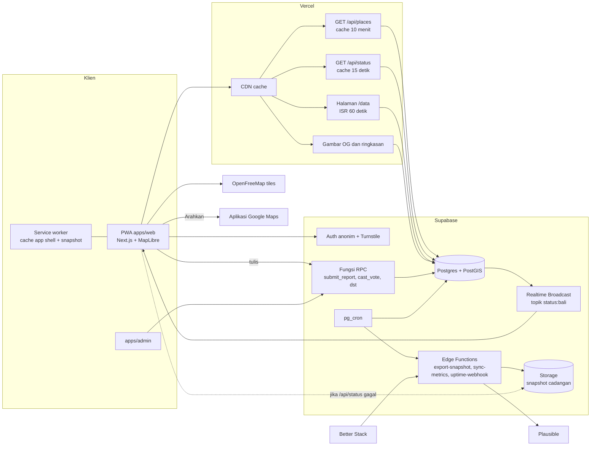
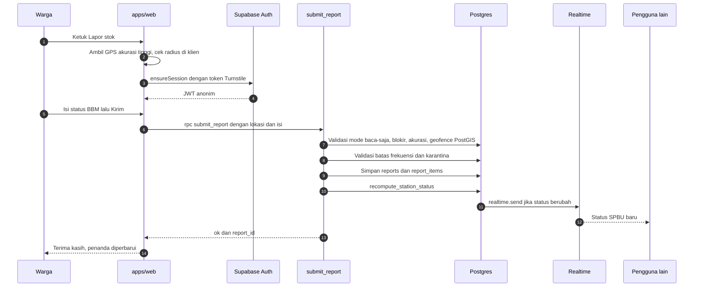

# ARCHITECTURE.md: Wenten BBM

Dokumen ini menjelaskan arsitektur teknis, alur data, keamanan, struktur monorepo, dan rencana operasional. Skema database ada di `ERD.md`, perilaku produk di `PRD.md`, tampilan di `DESIGN.md`.

---

## 1. Ringkasan keputusan

| Area | Pilihan | Alasan |
|---|---|---|
| Frontend | Next.js (App Router) + TypeScript, PWA dengan Serwist | SSR untuk halaman berbagi dan `/data`, PWA untuk offline dan "pasang ke layar utama" |
| Peta | MapLibre GL JS + tile vektor OpenFreeMap (gaya Positron), cadangan PMTiles Bali | Gratis tanpa kuota, ringan, gaya peta minim warna cocok dengan skema monokrom |
| Navigasi | Tautan Google Maps (`/maps/dir/?api=1&destination=`) | Tanpa biaya API, warga sudah terbiasa, navigasi suara tersedia |
| Backend | Supabase: Postgres + PostGIS, Auth anonim, Realtime Broadcast, Edge Functions, Storage, pg_cron | Satu platform, logika inti di database sehingga konsisten dan atomik |
| Hosting | Vercel Pro (region `sin1`), Supabase Pro (region Singapura) | Dekat dengan Bali, **paket berbayar sejak hari pertama** agar tidak dijeda saat trafik melonjak |
| Anti-bot | Cloudflare Turnstile pada pembuatan sesi anonim | Tak terlihat bagi warga, menghentikan skrip massal |
| Analitik | Plausible (ramah privasi) | Pengunjung unik dan online sekarang tanpa membebani database |
| Pemantauan | Sentry, Better Stack (uptime + notifikasi), log Supabase | |
| Monorepo | Turborepo + pnpm workspaces | Berbagi tipe, token desain, dan logika domain antara `web` dan `admin` |
| State klien | TanStack Query (data server) + Zustand (state UI) | |
| i18n | next-intl, `id` dan `en` | |
| Grafik | uPlot | Ringan untuk halaman `/data` |

## 2. Diagram arsitektur



Prinsip utamanya adalah **jalur baca dan jalur tulis dipisah**. Ribuan pengunjung yang hanya melihat peta dilayani dari cache CDN dan siaran realtime, sehingga database hanya menerima satu kueri baca per jendela cache, bukan satu per pengunjung. Database hanya bekerja keras untuk laporan, yang jumlahnya jauh lebih kecil.

## 3. Jalur baca

### 3.1 Dua snapshot

Data publik dipecah menjadi dua berdasarkan seberapa sering berubah.

**`/api/places`** berisi daftar tempat yang sudah disetujui. Jarang berubah, di-cache 10 menit.

```json
{
  "v": 3,
  "generated_at": "2026-10-15T12:10:00Z",
  "fuel_types": [[1, "pertalite", "Pertalite", "pertamina", true]],
  "places": [
    ["c1f0...", "spbu-kapal", "spbu", "pertamina", "54.803.xx",
     "SPBU Kapal", -8.5871, 115.1812, 2, true, [1, 2, 4]]
  ]
}
```

**`/api/status`** berisi status semua tempat yang tidak `unknown`, ringkasan se-Bali per jenis BBM, dan angka langsung. Di-cache 15 detik.

```json
{
  "generated_at": "2026-10-15T12:10:12Z",
  "online_now": 1204,
  "reports_total": 8310,
  "summary": { "1": [97, 12, 77, 122] },
  "stations": [
    ["c1f0...", "available", true, "medium", 25, 35, "2026-10-15T12:02:00Z",
     [[1, "available", true, "2026-10-15T12:02:00Z"], [2, "empty", false, "2026-10-15T11:20:00Z"]]]
  ]
}
```

Format array ringkas menekan ukuran payload. Header:

```
/api/places  Cache-Control: public, s-maxage=600, stale-while-revalidate=3600
/api/status  Cache-Control: public, s-maxage=15, stale-while-revalidate=60
```

`stale-while-revalidate` membuat pengunjung tetap dilayani dari cache lama saat database lambat, alih-alih menunggu atau gagal.

### 3.2 Alur di klien

1. Service worker langsung menampilkan app shell dan snapshot terakhir dari IndexedDB (jika ada), sehingga peta muncul seketika bahkan saat sinyal lemah.
2. Klien mengambil `/api/places` dan `/api/status`, lalu menggabungkannya di store.
3. Klien berlangganan topik Realtime Broadcast `status:bali` dan menerapkan perubahan per SPBU.
4. Jika kanal realtime gagal tersambung (misalnya kuota koneksi penuh) atau tab berada di latar belakang, klien beralih ke polling `/api/status` setiap 60 detik.
5. Jika `/api/status` gagal, klien mengambil `status.json` dari Storage (diperbarui tiap menit oleh `export-snapshot`).
6. Jarak, "Terdekat yang ada BBM", filter, dan pengurutan dihitung di klien, karena seluruh data Bali cukup kecil untuk dimuat sekaligus.

### 3.3 Halaman `/data`

Server component dengan `export const revalidate = 60`. Seluruh isi diambil dengan satu panggilan `public_dashboard()` yang hanya membaca tabel agregat (`report_stats_hourly`, `site_metrics_*`, ringkasan `uptime_checks`, `incidents`, `region_status_now`). Angka kartu dirender di server, grafik dirender uPlot di klien dari data yang sama. Halaman ini tidak pernah memindai tabel `reports` mentah.

## 4. Jalur tulis

### 4.1 Sesi anonim

Sesi anonim **dibuat secara malas**, hanya saat pengguna pertama kali melapor, memberi suara, atau masuk mode antre. Pengunjung yang hanya melihat peta tidak pernah menyentuh Auth, sehingga lonjakan pengunjung tidak membebani database.

```ts
// apps/web/features/session/ensure-session.ts
export async function ensureSession(supabase: SupabaseClient) {
  const { data } = await supabase.auth.getSession();
  if (data.session) return data.session;
  const captchaToken = await runTurnstile();          // widget tak terlihat
  const { data: signIn, error } = await supabase.auth.signInAnonymously({
    options: { captchaToken },
  });
  if (error) throw error;
  return signIn.session;
}
```

Batas pembuatan sesi anonim per IP diatur di pengaturan Auth Supabase.

### 4.2 Alur laporan



Jika jaringan putus saat mengirim, laporan disimpan di IndexedDB dan dikirim ulang lewat Background Sync atau saat halaman kembali online, dengan batas umur 10 menit.

### 4.3 Fungsi RPC

| Fungsi | Pemanggil | Ringkasan |
|---|---|---|
| `submit_report(p_station_id, p_lat, p_lng, p_accuracy_m, p_items, p_queue_level, p_wait_minutes, p_note)` | Warga | Validasi lengkap, simpan, hitung ulang, siarkan |
| `cast_vote(p_report_id, p_vote, p_lat, p_lng, p_accuracy_m)` | Warga | Geofence sama, tidak boleh vote laporan sendiri, satu suara per laporan, hitung ulang |
| `station_recent_reports(p_station_id, p_limit)` | Publik | 5 laporan aktif terbaru tanpa kolom sensitif, plus jumlah konfirmasi dan bantahan |
| `suggest_place(...)` (P1) | Warga | Tambah pengecer, pemeriksaan otomatis, status awal `pending` atau `quarantined` |
| `queue_start`, `queue_ping`, `queue_end` (P1) | Warga | Mode antre, hanya menerima jarak ke SPBU |
| `post_queue_message`, `flag_queue_message` (P1) | Warga | Kabar antrean dengan batas frekuensi |
| `recompute_station_status(p_station_id)` | Internal | Inti perhitungan status |
| `public_dashboard()` | Publik | Data halaman `/data` dalam satu JSON |
| `admin_*` | Admin | Sembunyikan, lepaskan karantina, blokir, ubah SPBU, pengumuman, gangguan, pengaturan. Semua menulis `admin_audit_log` |

Semua fungsi tulis memakai `security definer` dengan `set search_path`, dan mengembalikan `jsonb` berisi `ok` dan `code` alih-alih melempar exception, sehingga pencatatan `abuse_events` tidak ikut dibatalkan.

Kode galat yang dipetakan ke pesan antarmuka: `AUTH_REQUIRED`, `READ_ONLY`, `BLOCKED`, `STATION_NOT_FOUND`, `LOW_ACCURACY`, `OUT_OF_RANGE`, `RATE_LIMIT_STATION`, `RATE_LIMIT_HOURLY`, `INVALID_ITEMS`.

### 4.4 `submit_report`

```sql
create or replace function submit_report(
  p_station_id   uuid,
  p_lat          double precision,
  p_lng          double precision,
  p_accuracy_m   real,
  p_items        jsonb,              -- [{"fuel_type_id":1,"availability":"available"}]
  p_queue_level  queue_level default null,
  p_wait_minutes smallint    default null,
  p_note         text        default null
) returns jsonb
language plpgsql security definer
set search_path = public, extensions
as $$
declare
  v_uid      uuid := auth.uid();
  v_ip_hash  text := private.request_ip_hash();
  v_profile  profiles;
  v_station  stations;
  v_point    geography := st_setsrid(st_makepoint(p_lng, p_lat), 4326)::geography;
  v_dist     real;
  v_n_valid  int;
  v_status   moderation_status := 'active';
  v_reason   text;
  v_prev     record;
  v_id       uuid;
begin
  if v_uid is null then
    return jsonb_build_object('ok', false, 'code', 'AUTH_REQUIRED');
  end if;
  if setting_bool('read_only') then
    return jsonb_build_object('ok', false, 'code', 'READ_ONLY');
  end if;

  v_profile := ensure_profile(v_uid);
  if v_profile.is_blocked then
    perform log_abuse(v_uid, v_ip_hash, 'blocked_profile', p_station_id, null);
    return jsonb_build_object('ok', false, 'code', 'BLOCKED');
  end if;

  select * into v_station from stations
   where id = p_station_id and is_active
     and moderation_status = 'approved' and kind <> 'terminal';
  if not found then
    return jsonb_build_object('ok', false, 'code', 'STATION_NOT_FOUND');
  end if;

  if p_accuracy_m is null or p_accuracy_m > setting_num('max_accuracy_m') then
    perform log_abuse(v_uid, v_ip_hash, 'low_accuracy', p_station_id,
                      jsonb_build_object('accuracy_m', p_accuracy_m));
    return jsonb_build_object('ok', false, 'code', 'LOW_ACCURACY');
  end if;

  v_dist := st_distance(v_station.location, v_point);
  if v_dist > setting_num('geofence_m') then
    perform log_abuse(v_uid, v_ip_hash, 'out_of_range', p_station_id,
                      jsonb_build_object('distance_m', round(v_dist)));
    return jsonb_build_object('ok', false, 'code', 'OUT_OF_RANGE',
                              'distance_m', round(v_dist));
  end if;

  if exists (
    select 1 from reports
     where reporter_id = v_uid and station_id = p_station_id
       and created_at > now() - make_interval(mins => setting_num('station_cooldown_min')::int)
  ) then
    perform log_abuse(v_uid, v_ip_hash, 'rate_limit_station', p_station_id, null);
    return jsonb_build_object('ok', false, 'code', 'RATE_LIMIT_STATION');
  end if;

  if (select count(*) from reports
       where reporter_id = v_uid and created_at > now() - interval '1 hour')
     >= setting_num('hourly_report_limit') then
    perform log_abuse(v_uid, v_ip_hash, 'rate_limit_hourly', p_station_id, null);
    return jsonb_build_object('ok', false, 'code', 'RATE_LIMIT_HOURLY');
  end if;

  -- Setiap item harus jenis BBM yang dijual SPBU ini
  select count(*) into v_n_valid
    from jsonb_to_recordset(p_items) as i(fuel_type_id smallint, availability fuel_availability)
    join station_fuels sf
      on sf.station_id = p_station_id and sf.fuel_type_id = i.fuel_type_id;
  if v_n_valid = 0 or v_n_valid <> jsonb_array_length(p_items) then
    return jsonb_build_object('ok', false, 'code', 'INVALID_ITEMS');
  end if;

  -- Karantina senyap: lonjakan dari satu IP
  if (select count(*) from reports
       where ip_hash = v_ip_hash and created_at > now() - interval '1 hour')
     >= setting_num('ip_hourly_limit') then
    v_status := 'quarantined';
    v_reason := 'ip_burst';
  end if;

  -- Karantina senyap: perjalanan mustahil (lebih cepat dari 120 km/jam)
  select r.created_at, st_distance(s.location, v_station.location) as d
    into v_prev
    from reports r join stations s on s.id = r.station_id
   where r.reporter_id = v_uid
   order by r.created_at desc limit 1;
  if found and v_prev.d / greatest(extract(epoch from now() - v_prev.created_at), 1) > 33.3 then
    v_status := 'quarantined';
    v_reason := coalesce(v_reason || ',', '') || 'impossible_travel';
  end if;

  if v_status = 'quarantined' then
    perform log_abuse(v_uid, v_ip_hash, 'burst_quarantine', p_station_id,
                      jsonb_build_object('reason', v_reason));
  end if;

  insert into reports (station_id, reporter_id, queue_level, wait_minutes, note,
                       reporter_location, distance_m, accuracy_m,
                       moderation_status, quarantine_reason, ip_hash)
  values (p_station_id, v_uid, p_queue_level, p_wait_minutes, nullif(trim(p_note), ''),
          st_setsrid(st_makepoint(round(p_lng::numeric, 4), round(p_lat::numeric, 4)), 4326)::geography,
          v_dist, p_accuracy_m, v_status, v_reason, v_ip_hash)
  returning id into v_id;

  insert into report_items (report_id, fuel_type_id, availability)
  select v_id, i.fuel_type_id, i.availability
    from jsonb_to_recordset(p_items) as i(fuel_type_id smallint, availability fuel_availability);

  update profiles
     set report_count = report_count + 1, last_active_at = now()
   where id = v_uid;

  if v_status = 'active' then
    perform recompute_station_status(p_station_id);
  end if;

  -- Respons sama untuk laporan aktif maupun dikarantina, agar penyerang tidak tahu
  return jsonb_build_object('ok', true, 'report_id', v_id);
end;
$$;

revoke all on function submit_report from public;
grant execute on function submit_report to authenticated;
```

Fungsi pembantu: `ensure_profile(uid)` membuat baris `profiles` beserta `pseudonym` jika belum ada, `setting_num(key)` dan `setting_bool(key)` membaca `app_settings`, `log_abuse(...)` menulis `abuse_events`, dan `private.request_ip_hash()` membaca header `x-forwarded-for` dari `request.headers` lalu meng-hash-nya dengan garam harian yang disimpan di skema `private`.

### 4.5 `recompute_station_status`

```sql
create or replace function recompute_station_status(p_station uuid)
returns void
language plpgsql security definer
set search_path = public
as $$
declare
  v_window  interval := make_interval(mins => setting_num('status_window_min')::int);
  v_tau_s   numeric  := setting_num('decay_tau_min') * 60;
  v_min_w   numeric  := setting_num('min_weight');
  v_confirm interval := make_interval(mins => setting_num('confirm_window_min')::int);
  v_qwin    interval := make_interval(mins => setting_num('queue_window_min')::int);
  v_old     jsonb    := station_status_payload(p_station);
  v_new     jsonb;
begin
  -- 1. Status per jenis BBM
  with recent as (
    select ri.fuel_type_id, ri.availability, r.created_at, r.reporter_id, p.trust_score,
           coalesce(v.confirms, 0) as confirms, coalesce(v.disputes, 0) as disputes
      from reports r
      join report_items ri on ri.report_id = r.id
      join profiles p on p.id = r.reporter_id
      left join lateral (
        select count(*) filter (where vote = 'confirm') as confirms,
               count(*) filter (where vote = 'dispute') as disputes
          from report_votes where report_id = r.id
      ) v on true
     where r.station_id = p_station
       and r.moderation_status = 'active'
       and r.created_at > now() - v_window
  ),
  weighted as (
    select fuel_type_id, availability,
           sum(trust_score
               * exp(-extract(epoch from now() - created_at) / v_tau_s)
               * greatest(0, least(2, 1 + 0.3 * confirms - 0.5 * disputes))) as w,
           max(created_at) as last_at,
           count(*) as n,
           count(distinct reporter_id) filter (where created_at > now() - v_confirm) as recent_reporters
      from recent
     group by fuel_type_id, availability
  ),
  ranked as (
    select *,
           sum(w)       over (partition by fuel_type_id) as total_w,
           max(last_at) over (partition by fuel_type_id) as fuel_last_at,
           sum(n)       over (partition by fuel_type_id) as fuel_n,
           row_number() over (partition by fuel_type_id order by w desc, last_at desc) as rn
      from weighted
  )
  insert into station_fuel_status as t
         (station_id, fuel_type_id, status, confidence, is_confirmed,
          last_report_at, report_count, updated_at)
  select p_station, sf.fuel_type_id,
         case when r.total_w is null or r.total_w < v_min_w then 'unknown'
              else r.availability::text end::fuel_status,
         coalesce(round(r.w / nullif(r.total_w, 0), 2), 0),
         coalesce(r.total_w >= v_min_w and r.recent_reporters >= 2, false),
         r.fuel_last_at,
         coalesce(r.fuel_n, 0),
         now()
    from station_fuels sf
    left join ranked r on r.fuel_type_id = sf.fuel_type_id and r.rn = 1
   where sf.station_id = p_station
  on conflict (station_id, fuel_type_id) do update
     set status = excluded.status, confidence = excluded.confidence,
         is_confirmed = excluded.is_confirmed, last_report_at = excluded.last_report_at,
         report_count = excluded.report_count, updated_at = excluded.updated_at;

  -- 2. Status keseluruhan, antrean, perkiraan waktu tunggu
  insert into station_status as t
         (station_id, overall_status, is_confirmed, queue_level,
          wait_min_low, wait_min_high, last_report_at, updated_at)
  select p_station,
         case when bool_or(f.status = 'available') then 'available'
              when bool_or(f.status = 'limited')   then 'limited'
              when bool_or(f.status = 'empty')     then 'empty'
              else 'unknown' end::fuel_status,
         bool_or(f.is_confirmed and f.status <> 'unknown'),
         (select r.queue_level from reports r
           where r.station_id = p_station and r.moderation_status = 'active'
             and r.queue_level is not null and r.created_at > now() - v_qwin
           order by r.created_at desc limit 1),
         w.p25, w.p75,
         max(f.last_report_at),
         now()
    from station_fuel_status f
    cross join lateral (
      select case when count(*) >= 3
                  then (percentile_cont(0.25) within group (order by m))::smallint end as p25,
             case when count(*) >= 3
                  then (percentile_cont(0.75) within group (order by m))::smallint end as p75
        from (
          select wait_minutes as m from reports
           where station_id = p_station and moderation_status = 'active'
             and wait_minutes is not null and created_at > now() - v_qwin
          union all
          select wait_minutes from queue_sessions
           where station_id = p_station and end_reason = 'got_fuel'
             and ended_at > now() - v_qwin
        ) x
    ) w
   where f.station_id = p_station
   group by w.p25, w.p75
  on conflict (station_id) do update
     set overall_status = excluded.overall_status, is_confirmed = excluded.is_confirmed,
         queue_level = excluded.queue_level, wait_min_low = excluded.wait_min_low,
         wait_min_high = excluded.wait_min_high, last_report_at = excluded.last_report_at,
         updated_at = excluded.updated_at;

  -- 3. Siarkan hanya jika ada perubahan
  v_new := station_status_payload(p_station);
  if v_new is distinct from v_old then
    perform realtime.send(v_new, 'status', 'status:bali', false);
  end if;
end;
$$;
```

`station_status_payload(id)` menghasilkan JSON ringkas dengan format yang sama seperti satu baris `stations` di `/api/status`, tanpa kolom `updated_at`, sehingga perbandingan sebelum dan sesudah hanya mendeteksi perubahan yang berarti.

### 4.6 Job terjadwal (pg_cron)

| Job | Jadwal | Isi |
|---|---|---|
| `decay-status` | tiap 5 menit | `recompute_station_status` untuk SPBU yang punya laporan dalam 3 jam terakhir atau statusnya belum `unknown` |
| `stats-hourly` | tiap 5 menit | Upsert `report_stats_hourly` untuk jam berjalan dan jam sebelumnya |
| `export-snapshot` | tiap 1 menit | Panggil Edge Function (lewat `pg_net`) yang menulis `places.json` dan `status.json` ke Storage |
| `sync-metrics` | tiap 1 menit | Edge Function menarik pengunjung online dan unik dari Plausible ke `site_metrics_live` dan `site_metrics_hourly` |
| `queue-timeout` (P1) | tiap 5 menit | Tutup sesi antre tanpa ping lebih dari 15 menit dengan `end_reason = 'timeout'` |
| `retention` | harian 03.00 WITA | Hapus lokasi pelapor lebih dari 30 hari, `queue_pings` lebih dari 24 jam, `abuse_events` lebih dari 90 hari, ringkas `uptime_checks` |
| `rotate-ip-salt` | harian 00.00 WITA | Ganti garam hash IP |

Better Stack memeriksa `/api/health`, `/api/status`, dan URL snapshot Storage setiap menit, lalu mengirim webhook ke Edge Function `uptime-webhook` yang menulis `uptime_checks`. Admin melengkapi penjelasan di tabel `incidents`. Celah data pada bar ketersediaan ditampilkan sebagai "tidak ada data", bukan dianggap berjalan.

## 5. Realtime

- Satu topik publik `status:bali`, event `status`, payload satu SPBU per pesan (sekitar 200 byte).
- Klien menahan pembaruan selama 500 ms lalu menerapkannya sekaligus agar peta tidak berkedip saat banyak perubahan beruntun.
- Broadcast dikirim dari database lewat `realtime.send`, bukan memakai Postgres Changes, karena Broadcast lebih hemat untuk banyak pelanggan.
- Kuota koneksi realtime per paket terbatas. Klien wajib punya fallback polling, dan saat tab tidak aktif kanal ditutup untuk menghemat kuota.

## 6. Keamanan dan anti-penyalahgunaan

| Lapisan | Mekanisme |
|---|---|
| Bot | Turnstile saat membuat sesi anonim, batas sesi per IP di Supabase Auth |
| Identitas | Setiap tulis butuh JWT anonim, satu identitas per perangkat |
| Lokasi | Geofence 300 m dan akurasi maksimal 100 m, diperiksa PostGIS di server |
| Frekuensi | Jeda 30 menit per SPBU, 6 laporan per jam per perangkat, batas per hash IP |
| Pola | Karantina senyap untuk lonjakan per IP dan perjalanan mustahil, laporan dikarantina tidak memengaruhi status maupun grafik |
| Komunitas | Konfirmasi dan bantahan memengaruhi bobot, bantahan berulang masuk antrean moderasi |
| Tempat baru (P1) | Maksimal 3 per perangkat per hari, harus di daratan Bali, tidak dalam 50 m dari titik lain, tidak publik sampai disetujui |
| Data | RLS di semua tabel, `reports` tidak bisa dibaca publik, `service_role` hanya di Edge Functions dan server admin |
| Admin | Domain terpisah, login magic link email, daftar email yang diizinkan, cek `role = 'admin'`, log audit |
| Darurat | Sakelar `read_only` menghentikan semua tulis tanpa deploy ulang |
| Web | CSP ketat, HTTPS, header keamanan standar, input dibatasi panjang dan dibersihkan |

## 7. Struktur monorepo

```
wentenbbm/
├── apps/
│   ├── web/                              # PWA publik
│   │   ├── app/
│   │   │   ├── [locale]/
│   │   │   │   ├── page.tsx              # peta penuh layar
│   │   │   │   ├── spbu/[slug]/page.tsx  # tautan berbagi + metadata OG
│   │   │   │   ├── data/page.tsx         # halaman data publik (ISR 60 dtk)
│   │   │   │   └── tentang/page.tsx      # cara kerja, privasi, penafian
│   │   │   ├── api/
│   │   │   │   ├── places/route.ts
│   │   │   │   ├── status/route.ts
│   │   │   │   ├── health/route.ts
│   │   │   │   └── og/route.tsx          # gambar pratinjau dan ringkasan
│   │   │   ├── manifest.ts
│   │   │   └── sw.ts                     # Serwist
│   │   ├── features/
│   │   │   ├── map/                      # StationMap, ikon penanda, klaster, lapisan
│   │   │   ├── overlay/                  # IdentityCard, ControlCard, StatusStrip, ActionDock, MapLegend
│   │   │   ├── stations/                 # daftar, detail, terdekat yang ada BBM
│   │   │   ├── report/                   # ReportSheet, useGeofence, antrean offline
│   │   │   ├── queue/                    # mode antre dan kabar antrean (P1)
│   │   │   ├── data/                     # grafik uPlot, kartu statistik
│   │   │   └── session/                  # sesi anonim + Turnstile
│   │   ├── lib/                          # klien Supabase, realtime, store snapshot
│   │   └── messages/                     # id.json, en.json
│   └── admin/                            # panel admin
│       └── app/
│           ├── moderasi/
│           ├── karantina/
│           ├── spbu/
│           ├── pengumuman/
│           ├── gangguan/
│           ├── pengaturan/
│           └── audit/
├── packages/
│   ├── ui/                               # tokens.css, Button, Chip, BottomSheet, StatusGlyph, ...
│   ├── core/                             # tipe domain, enum, format WITA, jarak, label kesegaran, nearest
│   ├── db/
│   │   ├── supabase/
│   │   │   ├── config.toml
│   │   │   ├── migrations/               # 0001_extensions.sql, 0002_schema.sql, ...
│   │   │   ├── functions/                # export-snapshot, sync-metrics, uptime-webhook
│   │   │   ├── tests/                    # pgTAP: skenario status, geofence, rate limit
│   │   │   └── seed.sql
│   │   ├── scripts/
│   │   │   └── import-osm.ts             # impor SPBU Bali dari Overpass
│   │   └── src/
│   │       ├── types.gen.ts              # hasil supabase gen types
│   │       └── rpc.ts                    # pembungkus RPC bertipe
│   └── config/                           # eslint, tsconfig, preset tailwind
├── docs/                                 # PRD.md, DESIGN.md, ERD.md, ARCHITECTURE.md
├── .github/workflows/
│   ├── ci.yml
│   └── db-deploy.yml
├── turbo.json
├── pnpm-workspace.yaml
└── package.json
```

Aturan pembagian:

- **Logika status hanya ada di SQL.** `packages/core` tidak menghitung ulang status, hanya logika tampilan (label kesegaran, format waktu, jarak, pemilihan terdekat), agar tidak ada dua sumber kebenaran.
- `apps/*` tidak boleh mengimpor satu sama lain, hanya dari `packages/*`.
- Tipe database dihasilkan otomatis dan di-commit, CI gagal jika tidak sinkron dengan migrasi.

### Variabel lingkungan

| Variabel | Dipakai di | Rahasia |
|---|---|---|
| `NEXT_PUBLIC_SUPABASE_URL`, `NEXT_PUBLIC_SUPABASE_ANON_KEY` | web, admin | Tidak |
| `NEXT_PUBLIC_TURNSTILE_SITE_KEY` | web | Tidak |
| `NEXT_PUBLIC_MAP_STYLE_URL`, `NEXT_PUBLIC_MAP_FALLBACK_PMTILES` | web | Tidak |
| `NEXT_PUBLIC_SNAPSHOT_FALLBACK_URL` | web | Tidak |
| `STATUS_CACHE_SECONDS` | web (route handler) | Tidak |
| `SUPABASE_SERVICE_ROLE_KEY` | admin (server), Edge Functions | Ya |
| `TURNSTILE_SECRET_KEY` | Supabase Auth (pengaturan captcha) | Ya |
| `PLAUSIBLE_API_KEY` | Edge Function `sync-metrics` | Ya |
| `UPTIME_WEBHOOK_SECRET` | Edge Function `uptime-webhook` | Ya |
| `SENTRY_DSN` | web, admin | Tidak |

## 8. Lingkungan, CI/CD

| Lingkungan | Frontend | Database |
|---|---|---|
| Lokal | `pnpm dev` | `supabase start` (Docker) |
| Preview | Vercel Preview per PR | Proyek Supabase staging |
| Produksi | Vercel Production | Proyek Supabase produksi |

Alur CI di setiap PR: install, lint, typecheck, unit test (Vitest), `supabase db reset` + pgTAP, cek tipe database sinkron, build. Deploy preview otomatis.

Migrasi ke produksi lewat `db-deploy.yml` (`supabase db push`) yang berjalan di branch `main` dengan persetujuan manual. Frontend produksi otomatis dari `main`.

Tes pgTAP minimal untuk logika status:

1. Satu laporan "Ada" baru menghasilkan `available` dengan confidence 1.
2. Laporan "Ada" 45 menit lalu dan "Habis" 5 menit lalu menghasilkan `empty`.
3. Satu laporan 100 menit lalu menghasilkan `unknown`.
4. Dua pelapor berbeda sepakat dalam 30 menit menghasilkan `is_confirmed`.
5. Laporan dikarantina tidak memengaruhi status.
6. Geofence menolak 301 m dan menerima 299 m.
7. Laporan kedua di SPBU sama dalam 30 menit ditolak.
8. Laporan dari perangkat yang 10 menit sebelumnya melapor dari SPBU berjarak 40 km masuk karantina.

## 9. Skalabilitas dan mode darurat

| Tekanan | Respons |
|---|---|
| Lonjakan pengunjung | Dilayani CDN, perpanjang cache `/api/status` dari 15 ke 60 detik lewat `STATUS_CACHE_SECONDS` bila perlu |
| Kuota realtime penuh | Klien otomatis polling 60 detik |
| Database lambat | `stale-while-revalidate` tetap melayani data lama, naikkan ukuran compute Supabase |
| Serangan spam | Karantina otomatis, perketat ambang di `app_settings`, aktifkan `read_only` sementara jika perlu |
| Vercel bermasalah | Pengunjung lama tetap mendapat app shell dari service worker dan snapshot dari Storage. Opsional (P1): cermin statis di Cloudflare Pages yang membaca snapshot Storage |
| Tile peta bermasalah | Beralih ke PMTiles Bali yang di-host di Storage |

Perkiraan beban: pengunjung yang hanya melihat menghasilkan nol kueri database langsung. Setiap laporan menjalankan beberapa kueri berindeks untuk satu SPBU. Dengan ratusan laporan per menit pada puncak, beban tulis tetap kecil untuk satu instance Postgres.

### Pelajaran dari proyek serupa

Halaman data publik proyek komunitas sejenis di Bali mencatat tiga gangguan di 35 jam pertama. Pemetaannya ke desain ini:

| Gangguan yang tercatat | Antisipasi di Wenten BBM |
|---|---|
| Skrip mengirim ribuan laporan dan tempat palsu | Turnstile, batas per IP dan perangkat, karantina senyap, tempat baru tidak langsung publik |
| Database gratis kewalahan oleh spam ditambah trafik, laporan langsung terhenti | Jalur baca lewat CDN, sesi anonim dibuat malas, Supabase Pro, `/data` hanya membaca agregat |
| Akun hosting gratis dijeda karena trafik | Vercel Pro sejak rilis, snapshot cadangan di Storage, service worker |

## 10. Observability

- **Sentry**: galat di `web` dan `admin`, termasuk galat RPC per kode.
- **Supabase**: log kueri lambat, penggunaan koneksi, kuota realtime.
- **Better Stack**: uptime per menit, notifikasi ke grup admin (Telegram atau WhatsApp).
- **Dasbor internal di admin**: laporan per menit, rasio ditolak per alasan, jumlah karantina, SPBU dengan bantahan terbanyak.
- **Peringatan**: rasio laporan dikarantina di atas 20% dalam 10 menit, `/api/status` gagal 3 kali berturut-turut, umur snapshot Storage lebih dari 5 menit.

## 11. Jalan ke Level 2 dan 3

| Langkah | Perubahan |
|---|---|
| Level 2: akun | Aktifkan login Google atau OTP nomor HP, gunakan `linkIdentity` agar sesi anonim yang sama menjadi akun permanen, `role` berubah ke `citizen` |
| Level 2: reputasi | Job harian menghitung `trust_score` dari `confirmed_count` dan `disputed_count` (misalnya rentang 0,3 sampai 1,5), rumus bobot tidak berubah karena sudah memakai `trust_score` |
| Level 3: operator | Admin mengisi `station_operators`, laporan operator diberi bobot tetap tinggi dan label "Terverifikasi" di detail SPBU |
| Level 3: relawan | `role = 'volunteer'` untuk relawan banjar dengan bobot sedikit lebih tinggi dan batas frekuensi lebih longgar |

Tidak ada perubahan skema yang diperlukan, hanya fungsi, pengaturan, dan antarmuka.

## 12. Perkiraan biaya bulanan (kualitatif)

| Layanan | Paket | Catatan |
|---|---|---|
| Vercel | Pro | Wajib sejak rilis, paket gratis bisa dijeda saat trafik tinggi |
| Supabase | Pro, compute dinaikkan saat puncak | Biaya terbesar bila trafik sangat tinggi, bisa diturunkan setelah krisis |
| OpenFreeMap | Gratis | Donasi dianjurkan |
| Turnstile | Gratis | |
| Plausible | Berbayar sesuai pageview, atau self-host | |
| Better Stack, Sentry | Paket gratis cukup untuk awal | |
| Domain | Tahunan | |

Cek harga terbaru di situs masing-masing sebelum anggaran final.
