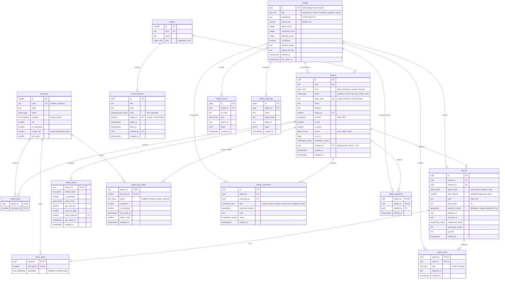
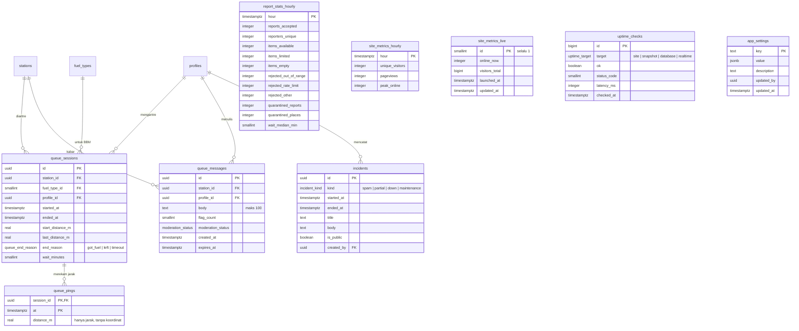

# ERD: Wenten BBM

Database: PostgreSQL 15+ di Supabase (region Singapura) dengan ekstensi `postgis`, `pg_cron`, dan `pgcrypto`. Semua waktu disimpan sebagai `timestamptz` (UTC) dan ditampilkan dalam WITA (`Asia/Makassar`).

Skema dirancang untuk kepercayaan **Level 1** (anonim) tetapi sudah memuat kolom dan tabel untuk Level 2 (akun dan reputasi) dan Level 3 (operator terverifikasi), sehingga naik level tidak memerlukan migrasi besar.

Tabel bertanda (P1) atau (L3) boleh dibuat sejak awal tetapi baru dipakai pada fase tersebut.

---

## 1. Diagram inti



## 2. Diagram antrean (P1) dan halaman data



## 3. Enum

| Enum | Nilai | Catatan |
|---|---|---|
| `region_kind` | `kabupaten`, `kota` | 8 kabupaten dan 1 kota di Bali |
| `place_kind` | `spbu`, `pertashop`, `retailer`, `terminal` | `terminal` = TBBM, tidak bisa dilaporkan |
| `brand_type` | `pertamina`, `shell`, `bp`, `vivo`, `other`, `none` | |
| `place_source` | `osm`, `admin`, `user` | |
| `moderation_status` | `approved`, `active`, `pending`, `quarantined`, `hidden`, `rejected` | Tempat memakai `approved/pending/quarantined/rejected`, laporan dan kabar memakai `active/quarantined/hidden` |
| `fuel_category` | `bensin`, `diesel` | |
| `fuel_availability` | `available`, `limited`, `empty` | Nilai yang dikirim warga ("Tidak tahu" tidak disimpan) |
| `fuel_status` | `available`, `limited`, `empty`, `unknown` | Hasil perhitungan |
| `queue_level` | `none`, `short`, `medium`, `long` | Pendek < 10 kendaraan, sedang 10 sampai 30, panjang > 30 |
| `vote_type` | `confirm`, `dispute` | |
| `app_role` | `anonymous`, `citizen`, `volunteer`, `operator`, `admin` | Level 1 hanya memakai `anonymous` dan `admin` |
| `announcement_level` | `info`, `important` | |
| `correction_kind` | `wrong_location`, `closed`, `wrong_fuels`, `duplicate`, `other` | |
| `abuse_kind` | `out_of_range`, `low_accuracy`, `rate_limit_station`, `rate_limit_hourly`, `burst_quarantine`, `blocked_profile`, `place_rejected`, `message_flagged` | |
| `queue_end_reason` | `got_fuel`, `left`, `timeout` | |
| `incident_kind` | `spam`, `partial`, `down`, `maintenance` | |
| `uptime_target` | `site`, `snapshot`, `database`, `realtime` | |

## 4. Catatan per tabel

**`stations`** menampung semua titik di peta: SPBU, Pertashop, pengecer, dan terminal BBM. Satu tabel memudahkan satu snapshot dan satu lapisan peta. Titik dengan `source = user` mulai dari `pending` atau `quarantined` dan tidak masuk snapshot publik sampai `approved`.

**`fuel_types`** berisi produk per merek: Pertalite, Pertamax, Pertamax Turbo, Pertamax Green, Biosolar, Dexlite, Pertamina Dex, serta produk Shell, BP, dan Vivo. `category` dan `ron` memungkinkan filter lintas merek di masa depan. `is_filter_tab` menentukan tab utama (Pertalite, Pertamax, Solar).

**`profiles`** dibuat otomatis saat sesi anonim pertama kali melakukan tulis (lapor, vote, antre). `pseudonym` dihasilkan dari hash ID. Saat naik ke Level 2, sesi anonim di-*link* ke identitas Google atau nomor HP tanpa mengganti `id`, sehingga riwayat laporan tetap utuh.

**`reports`** adalah satu kunjungan pelapor ke satu SPBU. Status per BBM ada di `report_items`, sehingga satu laporan bisa mencakup Pertalite Ada dan Pertamax Habis sekaligus. Tabel ini **tidak bisa dibaca langsung oleh publik**, karena memuat lokasi pelapor dan hash IP. Publik membaca lewat fungsi `station_recent_reports()` yang hanya mengembalikan kolom aman.

**`station_fuel_status`** dan **`station_status`** adalah tabel hasil hitung (cache) yang diperbarui oleh `recompute_station_status()`. Dipisah dari `stations` agar pembaruan yang sangat sering tidak mengunci data induk dan agar siaran realtime hanya membawa data status.

**`report_stats_hourly`** diisi job terjadwal setiap 5 menit untuk jam berjalan dan jam sebelumnya. Halaman `/data` hanya membaca tabel agregat ini, tidak pernah memindai `reports` secara langsung.

**`site_metrics_*`** diisi job yang menarik angka dari layanan analitik ramah privasi (pengunjung unik, online sekarang), sehingga penghitungan pengunjung tidak membebani database.

**`uptime_checks`** diisi oleh pemantau eksternal lewat webhook dan oleh job internal, lalu diringkas menjadi bar ketersediaan di `/data`.

## 5. DDL

```sql
-- Ekstensi
create extension if not exists postgis;
create extension if not exists pg_cron;
create extension if not exists pgcrypto;

-- Enum
create type region_kind as enum ('kabupaten','kota');
create type place_kind as enum ('spbu','pertashop','retailer','terminal');
create type brand_type as enum ('pertamina','shell','bp','vivo','other','none');
create type place_source as enum ('osm','admin','user');
create type moderation_status as enum ('approved','active','pending','quarantined','hidden','rejected');
create type fuel_category as enum ('bensin','diesel');
create type fuel_availability as enum ('available','limited','empty');
create type fuel_status as enum ('available','limited','empty','unknown');
create type queue_level as enum ('none','short','medium','long');
create type vote_type as enum ('confirm','dispute');
create type app_role as enum ('anonymous','citizen','volunteer','operator','admin');
create type announcement_level as enum ('info','important');
create type correction_kind as enum ('wrong_location','closed','wrong_fuels','duplicate','other');
create type abuse_kind as enum ('out_of_range','low_accuracy','rate_limit_station','rate_limit_hourly',
  'burst_quarantine','blocked_profile','place_rejected','message_flagged');
create type queue_end_reason as enum ('got_fuel','left','timeout');
create type incident_kind as enum ('spam','partial','down','maintenance');
create type uptime_target as enum ('site','snapshot','database','realtime');

-- Referensi
create table regions (
  id smallint primary key,
  slug text not null unique,
  name text not null,
  kind region_kind not null
);

create table profiles (
  id uuid primary key references auth.users(id) on delete cascade,
  role app_role not null default 'anonymous',
  pseudonym text not null,
  trust_score numeric(3,2) not null default 1.00 check (trust_score between 0 and 2),
  report_count integer not null default 0,
  confirmed_count integer not null default 0,
  disputed_count integer not null default 0,
  is_blocked boolean not null default false,
  blocked_reason text,
  signup_ip_hash text,
  created_at timestamptz not null default now(),
  last_active_at timestamptz not null default now()
);

create table stations (
  id uuid primary key default gen_random_uuid(),
  slug text not null unique,
  kind place_kind not null default 'spbu',
  brand brand_type not null default 'pertamina',
  spbu_code text unique,
  name text not null,
  address text,
  region_id smallint references regions(id),
  location geography(Point, 4326) not null,
  is_24h boolean not null default false,
  is_active boolean not null default true,
  source place_source not null default 'osm',
  osm_id bigint unique,
  moderation_status moderation_status not null default 'approved',
  created_by uuid references profiles(id),
  created_at timestamptz not null default now(),
  updated_at timestamptz not null default now()
);
create index stations_location_gix on stations using gist (location);
create index stations_region_idx on stations (region_id);
create index stations_public_idx on stations (kind) where is_active and moderation_status = 'approved';

create table fuel_types (
  id smallint primary key,
  code text not null unique,
  name text not null,
  brand brand_type not null,
  category fuel_category not null,
  ron smallint,
  is_subsidized boolean not null default false,
  is_filter_tab boolean not null default false,
  sort_order smallint not null default 100
);

create table station_fuels (
  station_id uuid references stations(id) on delete cascade,
  fuel_type_id smallint references fuel_types(id),
  primary key (station_id, fuel_type_id)
);

-- Laporan
create table reports (
  id uuid primary key default gen_random_uuid(),
  station_id uuid not null references stations(id) on delete cascade,
  reporter_id uuid not null references profiles(id),
  queue_level queue_level,
  wait_minutes smallint check (wait_minutes between 0 and 600),
  note text check (char_length(note) <= 140),
  photo_path text,
  reporter_location geography(Point, 4326),
  distance_m real not null,
  accuracy_m real not null,
  moderation_status moderation_status not null default 'active',
  quarantine_reason text,
  ip_hash text,
  created_at timestamptz not null default now()
);
create index reports_station_time_idx on reports (station_id, created_at desc)
  where moderation_status = 'active';
create index reports_reporter_time_idx on reports (reporter_id, created_at desc);
create index reports_ip_time_idx on reports (ip_hash, created_at desc);
create index reports_time_brin on reports using brin (created_at);

create table report_items (
  report_id uuid references reports(id) on delete cascade,
  fuel_type_id smallint references fuel_types(id),
  availability fuel_availability not null,
  primary key (report_id, fuel_type_id)
);

create table report_votes (
  report_id uuid references reports(id) on delete cascade,
  voter_id uuid references profiles(id),
  vote vote_type not null,
  distance_m real not null,
  created_at timestamptz not null default now(),
  primary key (report_id, voter_id)
);

-- Status hasil hitung
create table station_fuel_status (
  station_id uuid references stations(id) on delete cascade,
  fuel_type_id smallint references fuel_types(id),
  status fuel_status not null default 'unknown',
  confidence numeric(3,2) not null default 0,
  is_confirmed boolean not null default false,
  last_report_at timestamptz,
  report_count smallint not null default 0,
  updated_at timestamptz not null default now(),
  primary key (station_id, fuel_type_id)
);

create table station_status (
  station_id uuid primary key references stations(id) on delete cascade,
  overall_status fuel_status not null default 'unknown',
  is_confirmed boolean not null default false,
  queue_level queue_level,
  wait_min_low smallint,
  wait_min_high smallint,
  active_queuers smallint not null default 0,
  last_report_at timestamptz,
  updated_at timestamptz not null default now()
);

-- Konten dan moderasi
create table announcements (
  id uuid primary key default gen_random_uuid(),
  title text not null,
  body text not null,
  level announcement_level not null default 'info',
  region_id smallint references regions(id),
  starts_at timestamptz not null default now(),
  ends_at timestamptz not null,
  created_by uuid references profiles(id),
  created_at timestamptz not null default now()
);

create table station_corrections (
  id uuid primary key default gen_random_uuid(),
  station_id uuid not null references stations(id) on delete cascade,
  proposed_by uuid not null references profiles(id),
  kind correction_kind not null,
  proposed_location geography(Point, 4326),
  note text check (char_length(note) <= 280),
  status moderation_status not null default 'pending',
  created_at timestamptz not null default now()
);

create table station_operators (
  station_id uuid references stations(id) on delete cascade,
  profile_id uuid references profiles(id) on delete cascade,
  verified_by uuid references profiles(id),
  verified_at timestamptz,
  primary key (station_id, profile_id)
);

create table abuse_events (
  id bigint generated always as identity primary key,
  profile_id uuid references profiles(id),
  ip_hash text,
  kind abuse_kind not null,
  station_id uuid,
  detail jsonb,
  created_at timestamptz not null default now()
);
create index abuse_events_time_idx on abuse_events (created_at desc);
create index abuse_events_profile_idx on abuse_events (profile_id, created_at desc);

create table admin_audit_log (
  id bigint generated always as identity primary key,
  admin_id uuid not null references profiles(id),
  action text not null,
  target_table text not null,
  target_id text not null,
  detail jsonb,
  created_at timestamptz not null default now()
);

create table app_settings (
  key text primary key,
  value jsonb not null,
  description text,
  updated_by uuid references profiles(id),
  updated_at timestamptz not null default now()
);

-- Antrean (P1)
create table queue_sessions (
  id uuid primary key default gen_random_uuid(),
  station_id uuid not null references stations(id) on delete cascade,
  fuel_type_id smallint references fuel_types(id),
  profile_id uuid not null references profiles(id),
  started_at timestamptz not null default now(),
  ended_at timestamptz,
  start_distance_m real not null,
  last_distance_m real not null,
  end_reason queue_end_reason,
  wait_minutes smallint
);
create unique index queue_sessions_one_open on queue_sessions (profile_id) where ended_at is null;
create index queue_sessions_station_idx on queue_sessions (station_id, started_at desc);

create table queue_pings (
  session_id uuid references queue_sessions(id) on delete cascade,
  at timestamptz not null default now(),
  distance_m real not null,
  primary key (session_id, at)
);

create table queue_messages (
  id uuid primary key default gen_random_uuid(),
  station_id uuid not null references stations(id) on delete cascade,
  profile_id uuid not null references profiles(id),
  body text not null check (char_length(body) between 1 and 100),
  flag_count smallint not null default 0,
  moderation_status moderation_status not null default 'active',
  created_at timestamptz not null default now(),
  expires_at timestamptz not null default now() + interval '2 hours'
);
create index queue_messages_station_idx on queue_messages (station_id, created_at desc)
  where moderation_status = 'active';

-- Halaman data
create table report_stats_hourly (
  hour timestamptz primary key,
  reports_accepted integer not null default 0,
  reporters_unique integer not null default 0,
  items_available integer not null default 0,
  items_limited integer not null default 0,
  items_empty integer not null default 0,
  rejected_out_of_range integer not null default 0,
  rejected_rate_limit integer not null default 0,
  rejected_other integer not null default 0,
  quarantined_reports integer not null default 0,
  quarantined_places integer not null default 0,
  wait_median_min smallint
);

create table site_metrics_hourly (
  hour timestamptz primary key,
  unique_visitors integer not null default 0,
  pageviews integer not null default 0,
  peak_online integer not null default 0
);

create table site_metrics_live (
  id smallint primary key default 1 check (id = 1),
  online_now integer not null default 0,
  visitors_total bigint not null default 0,
  launched_at timestamptz not null,
  updated_at timestamptz not null default now()
);

create table uptime_checks (
  id bigint generated always as identity primary key,
  target uptime_target not null,
  ok boolean not null,
  status_code smallint,
  latency_ms integer,
  checked_at timestamptz not null default now()
);
create index uptime_checks_time_idx on uptime_checks (target, checked_at desc);

create table incidents (
  id uuid primary key default gen_random_uuid(),
  kind incident_kind not null,
  started_at timestamptz not null,
  ended_at timestamptz,
  title text not null,
  body text not null,
  is_public boolean not null default true,
  created_by uuid references profiles(id)
);

-- Kondisi sekarang per wilayah, untuk /data
create view region_status_now as
select s.region_id,
       sfs.fuel_type_id,
       count(*) filter (where sfs.status = 'available') as available,
       count(*) filter (where sfs.status = 'limited')   as limited,
       count(*) filter (where sfs.status = 'empty')     as empty,
       count(*) filter (where sfs.status = 'unknown')   as unknown
from stations s
join station_fuel_status sfs on sfs.station_id = s.id
where s.kind = 'spbu' and s.is_active and s.moderation_status = 'approved'
group by s.region_id, sfs.fuel_type_id;
```

## 6. Data awal

```sql
insert into regions (id, slug, name, kind) values
 (1,'denpasar','Kota Denpasar','kota'),
 (2,'badung','Badung','kabupaten'),
 (3,'gianyar','Gianyar','kabupaten'),
 (4,'tabanan','Tabanan','kabupaten'),
 (5,'jembrana','Jembrana','kabupaten'),
 (6,'buleleng','Buleleng','kabupaten'),
 (7,'bangli','Bangli','kabupaten'),
 (8,'klungkung','Klungkung','kabupaten'),
 (9,'karangasem','Karangasem','kabupaten');

insert into app_settings (key, value, description) values
 ('status_window_min',    '120',   'Jendela laporan yang dihitung (menit)'),
 ('decay_tau_min',        '60',    'Konstanta peluruhan (menit)'),
 ('min_weight',           '0.2',   'Ambang total bobot sebelum status menjadi unknown'),
 ('confirm_window_min',   '30',    'Jendela untuk tanda dikonfirmasi warga'),
 ('geofence_m',           '300',   'Jarak maksimal pelapor ke SPBU (meter)'),
 ('max_accuracy_m',       '100',   'Akurasi GPS terburuk yang diterima (meter)'),
 ('station_cooldown_min', '30',    'Jeda lapor per SPBU per perangkat (menit)'),
 ('hourly_report_limit',  '6',     'Maksimal laporan per perangkat per jam'),
 ('ip_hourly_limit',      '40',    'Maksimal laporan per hash IP per jam sebelum karantina'),
 ('queue_window_min',     '60',    'Jendela tingkat antrean dan waktu tunggu (menit)'),
 ('read_only',            'false', 'Mode baca-saja darurat');
```

Data SPBU diimpor dari OpenStreetMap (`amenity=fuel` di dalam batas Provinsi Bali) lewat skrip `packages/db/scripts/import-osm.ts`, lalu diverifikasi manual: nama, nomor SPBU dari tag `ref` atau nama, merek dari tag `brand`, dan jenis BBM dari tag `fuel:*` jika ada (jika tidak, diisi bawaan per merek).

## 7. Row Level Security

RLS aktif di semua tabel. Prinsipnya: **publik hanya membaca data yang aman, semua penulisan lewat fungsi `security definer` yang memvalidasi di server.**

| Tabel | anon / authenticated (baca) | anon / authenticated (tulis) | admin |
|---|---|---|---|
| `regions`, `fuel_types`, `station_fuels` | Ya | Tidak | Penuh |
| `stations` | Hanya `is_active` dan `approved` (plus milik sendiri yang `pending`) | Lewat `suggest_place()` | Penuh |
| `station_status`, `station_fuel_status` | Ya | Tidak (hanya fungsi) | Baca |
| `reports`, `report_items`, `report_votes` | Tidak, lewat `station_recent_reports()` | Lewat `submit_report()`, `cast_vote()` | Penuh |
| `queue_messages` | Hanya `active` dan belum kedaluwarsa, tanpa `profile_id` (lewat view) | Lewat `post_queue_message()` | Penuh |
| `queue_sessions`, `queue_pings` | Hanya milik sendiri | Lewat `queue_start()`, `queue_ping()`, `queue_end()` | Baca |
| `announcements` | Hanya yang sedang tayang | Tidak | Penuh |
| `report_stats_hourly`, `site_metrics_*`, `uptime_checks`, `incidents` (public) | Ya | Tidak | Penuh |
| `profiles` | Hanya baris sendiri | Tidak | Penuh |
| `abuse_events`, `admin_audit_log`, `app_settings` | Tidak (kecuali `app_settings` kunci publik lewat fungsi) | Tidak | Penuh |

Peran admin diperiksa dengan fungsi `is_admin()` yang membaca `profiles.role`.

## 8. Retensi data

| Data | Retensi |
|---|---|
| `reports.reporter_location` | Diubah menjadi `null` setelah 30 hari |
| `reports.ip_hash`, `abuse_events.ip_hash` | Hash dengan garam harian yang dirotasi, tidak bisa dihubungkan antarhari |
| `queue_pings` | Dihapus setelah 24 jam |
| `queue_messages` | Disembunyikan setelah `expires_at`, dihapus setelah 7 hari |
| `abuse_events` | 90 hari |
| `uptime_checks` | Diringkas per jam setelah 7 hari |
| `reports`, `report_items`, `report_votes` | Disimpan selama proyek berjalan untuk data agregat, tanpa data lokasi |
